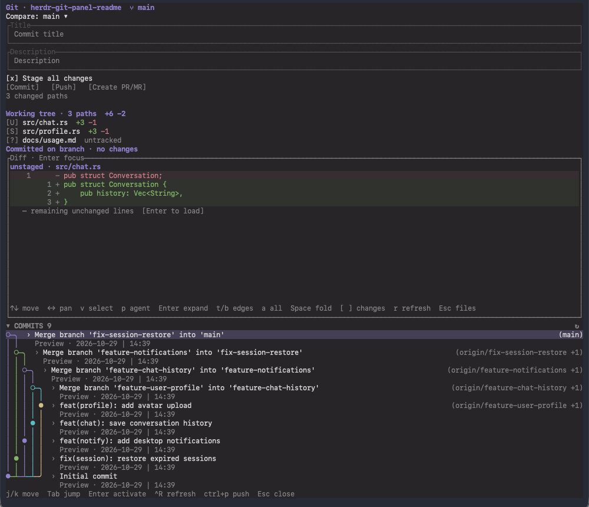

# Herdr Git Panel

A Git sidebar for [Herdr](https://herdr.dev), with searchable branches, commit history, diffs, commits, push, and GitHub/GitLab merge requests. The panel follows your existing Herdr theme.

## Features

- **Branch comparison:** defaults to the current local branch. Search local and already fetched remote branches by name to choose another comparison. The panel never fetches automatically.
- **Working-tree changes:** browse unstaged, staged and untracked files. The selected file's diff appears directly below the file lists.
- **Send selected changes to an agent:** select diff lines and press `p` to choose an available Herdr agent pane in the current workspace.
- **Committed changes:** see file statistics between the selected comparison branch and the current branch.
- **Commit history:** browse a colored branch/merge graph. Expand multiple commits independently to inspect their file statistics and diffs. History starts collapsed to leave more room for working-tree changes.
- **Commit:** enter a title and multiline description. Stage all changes, or commit only files already staged.
- **Create PR/MR:** choose the remote, source branch, target branch, title and description. After creation, a clickable `!MR number ↗` link appears beside Create PR/MR. The action buttons size to their text and move the PR/MR button and link onto a second row when space is limited. Push the source branch before creating the request.
- **Push:** push the current branch to the destination derived from the comparison branch. A confirmation shows the destination before pushing.
- **Automatic refresh:** local file and Git changes update the panel while preserving your draft, selection and expanded commits.
- **Follow worktrees:** the panel follows the last focused terminal in its tab when its working directory changes to another repository or worktree. Commit drafts are kept separately for each repository path.
- **Open with worktrees:** creating or opening a worktree workspace opens the panel beside its first pane without taking focus. Reopening a live workspace does not reopen a panel you closed.

### Panel preview

The panel combines branch selection, working-tree changes, commit controls, inline diffs, and commit history. Each commit shows its message, author, and date (`YYYY-MM-DD | HH:mm`) on two compact lines, with a colored graph for branch and merge relationships.



| Action | Shortcut |
| --- | --- |
| Open / close the panel | `Cmd+Shift+R` after setup |
| Jump between focus areas | `Tab` / `Shift+Tab` |
| Navigate rows and cross section boundaries | `j` / `k`, `↑` / `↓` |
| Scroll within the hovered list | Mouse wheel |
| Stage / unstage the selected changed file | `Space` |
| Discard all changes to the selected changed file | `d`, then `y` to confirm or `n` to cancel |
| Expand a commit / focus the selected diff | `Enter` |
| Open the selected diff in a popup | `Shift+Enter` from the inline diff, or `o` from the file list |
| Select diff lines / choose an agent target | `v`, then arrows / `p` |
| Commit | `Ctrl+S` |
| Push | `Ctrl+P`, configurable |
| Refresh | `Ctrl+R` |
| Open the created MR / PR | Click its link, or focus it and press `Enter` |
| Return from inline diff / close a dialog or panel | `Esc` |

In the working-tree file list, `Space` stages an unstaged or untracked file and
unstages a staged file while keeping its working copy. To commit only staged files,
clear **Stage all changes** in the commit form. `d` opens a file-specific confirmation:
`y` discards both staged and unstaged changes to HEAD, or deletes a newly added
file; `n` or `Esc` cancels. Files changed after confirmation opens require a fresh
confirmation. Directory and submodule discards use their own Git workflow.

Outside text inputs, `j` / `k` move through rows and continue into the adjacent
focus area at a boundary. Entering a list or diff from above selects its first row;
entering from below selects its last. Tab jumps directly between areas while
retaining their positions. Active diff selections keep navigation inside the diff.

Selecting a file previews its diff inline. With commit history collapsed, the
preview fills the space below the compact file lists; expanded history shares
that space with the preview. Press `Enter` on a file or click the preview to read
it, and `Esc` to return to the file list. File clicks select without opening a popup.
Press `Shift+Enter` in the inline diff for a larger popup covering 90% of the
Herdr workspace width and 88% of its height. Both views share the same diff controls,
including `v`, `p`, `Enter` and `a`. The popup reads the current file again; the inline
view keeps its own cursor, selection and folds. Outside Herdr, it opens a local dialog.
`Shift+Enter` requires a terminal that reports modified Enter keys.

Diffs show each change with **five unchanged lines before and after**, fixed
old/new line numbers, and folds for more distant context. Overlapping context
windows appear once. Use `↑` / `↓` to move, `←` / `→` to pan code horizontally, `PageUp` /
`PageDown` to move by a viewport, and `[` / `]` to jump between changes.
On a folded row, `Enter` expands 20 lines next to the change (`t` explicitly expands
from the beginning, `b` from the end), and `a` expands the whole
interval. Click the left/right half of a folded row to expand from the
beginning/end; Shift-click expands the whole
interval. Press `Space` on expanded context or its remaining fold to collapse that
interval again.

Context outside the patch loads in the background only when requested. If a working
file has changed since the diff opened, expansion asks you to press `r` to refresh.
Committed and staged context stays pinned to the version shown in the diff.
Refresh restores the selected source line when it still exists. Inserted/deleted
lines follow Herdr's theme, with bounded inline emphasis for edited portions of
paired lines.

In either diff view, press `v` and move with arrows or `j` / `k` to select lines.
Mouse drag and Shift-click also select a range. Press `p` to choose an idle or done
agent in the current workspace, then `Enter` or **Send** to paste the selection
into its input. Review or edit it there and press Enter to submit. The text includes
the repository, file, comparison, old/new line numbers and complete selected lines.
Folded intervals are marked as omitted. Escape first cancels the target picker or
selection, then returns from the inline diff to the file list.

While selecting or choosing a target, the diff snapshot stays stable across file
updates. Selections are limited to 2,000 source lines and 128 KiB including context
information. After an unconfirmed delivery, inspect the target's input and press
`r` in the picker to reload targets before retrying.

## Installation

Requires **Herdr ≥0.9.5**, Git, and macOS or Linux. Creating requests also requires an authenticated `gh` for GitHub or `glab` for GitLab.

### Install from GitHub

Requires **Rust ≥1.88** and Cargo:

```sh
herdr plugin install Zeppelinpp/herdr-git-panel
```

This installs the latest code from the repository's default branch. To update later:

```sh
herdr plugin update zeppelinpp.git-panel
```

Close and reopen an existing panel after updating.

To install a specific published version:

```sh
herdr plugin install Zeppelinpp/herdr-git-panel --ref v0.7.1
```

`plugin update` follows the installation's saved source/ref. A version pinned with
`--ref` stays on that ref; install the new tag explicitly to move to another release.

Add this shortcut to `~/.config/herdr/config.toml`:

```toml
[[keys.command]]
key = "cmd+shift+r"
type = "plugin_action"
command = "zeppelinpp.git-panel.toggle"
description = "Toggle Git panel"
```

Reload the config:

```sh
herdr server reload-config
```

If your terminal reserves `Cmd+Shift+R`, configure it to forward the shortcut or choose another key. On Linux, choose a shortcut your terminal transmits.

### Install a prebuilt release

Download the matching archive and `SHA256SUMS` from [the latest release](https://github.com/Zeppelinpp/herdr-git-panel/releases/latest). Rust is not required.

| Platform | Archive target |
| --- | --- |
| macOS Apple Silicon | `aarch64-apple-darwin` |
| macOS Intel | `x86_64-apple-darwin` |
| Linux ARM64 | `aarch64-unknown-linux-gnu` |
| Linux x86_64 | `x86_64-unknown-linux-gnu` |

Linux archives require glibc ≥2.35, such as Ubuntu 22.04 or newer. For other Linux environments, install from source.

Verify the archive against `SHA256SUMS`, extract it to a permanent location, then run inside the extracted directory:

```sh
./bin/herdr-git-panel setup
```

Setup registers that directory, adds the shortcut and reloads Herdr config. Keep the directory in place. Release archives contain the latest published release; they may lag behind the default branch.

### Install a local checkout

```sh
git clone https://github.com/Zeppelinpp/herdr-git-panel.git
cd herdr-git-panel
sh scripts/build.sh
./bin/herdr-git-panel setup
```

For later local changes, rerun `sh scripts/build.sh`, then close and reopen the panel. No Herdr restart is needed. Locally linked installations are updated by rebuilding, rather than `herdr plugin update`.

## Configuration

Find the plugin's configuration directory:

```sh
herdr plugin config-dir zeppelinpp.git-panel
```

The default file is:

```text
~/.config/herdr/plugins/config/zeppelinpp.git-panel/config.json
```

Create or edit `config.json`, then close and reopen the panel. A complete example:

```json
{
  "direction": "right",
  "push_key": "ctrl+p",
  "history_limit": 150,
  "auto_refresh": true,
  "default_remote": "origin",
  "hosts": {
    "git.kingdee.com": "gitlab",
    "github.company.example": "github"
  }
}
```

| Setting | Default | Description |
| --- | --- | --- |
| `direction` | `right` | Split direction relative to the invoking pane: `right` or `down`. Takes effect when the panel is reopened. Herdr does not currently support `left` or `up`. |
| `push_key` | `ctrl+p` | Shortcut that opens push confirmation. |
| `history_limit` | `150` | Commits loaded initially and per “Load older commits” action. Must be greater than zero. |
| `auto_refresh` | `true` | Automatically refresh local changes. Set to `false` to refresh manually with `Ctrl+R`. |
| `default_remote` | `origin` | MR / PR form fallback when the comparison has no push destination. |
| `hosts` | `{}` | Map self-hosted Git server hostnames to `gitlab` or `github`. |

### Self-hosted GitHub / GitLab

For a domain such as `git.kingdee.com`, set its platform explicitly in `hosts`. Use the hostname only, without `https://` or a repository path.

An `Unknown forge` message means the selected remote's hostname needs this mapping. Ensure the corresponding CLI is installed and authenticated against that server before retrying. Authentication stays with Git, `gh` and `glab`.

### Push destination

The comparison branch determines where the current branch is pushed:

| Selected comparison | Destination |
| --- | --- |
| `origin/release` | `origin`, branch `release` |
| Local `release`, tracking `upstream/stable` | `upstream`, branch `stable` |
| Local `release`, without an upstream | `origin`, branch `release`, if `origin` exists |

The confirmation shows the exact destination. Push does not force-update branches or change upstream settings.

### Theme and refresh

Colors follow Herdr's configured theme, including custom colors and accent. After changing the Herdr theme, press `Ctrl+R` or reopen the panel.

If automatic refresh is unavailable, the panel shows a message and manual refresh remains available. Network filesystems and very large Linux directory trees may need manual refresh. The panel never fetches remote branches; fetch through your normal Git workflow first.
